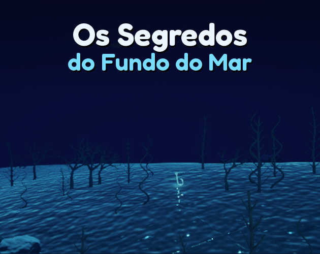
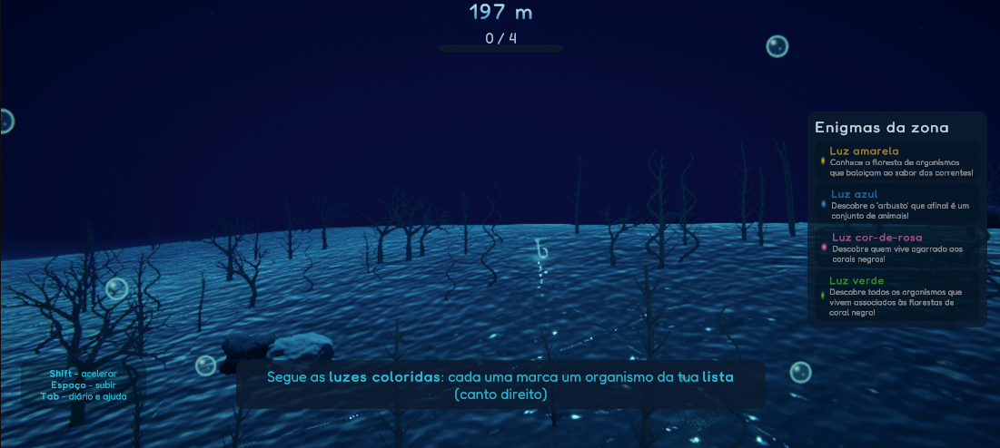
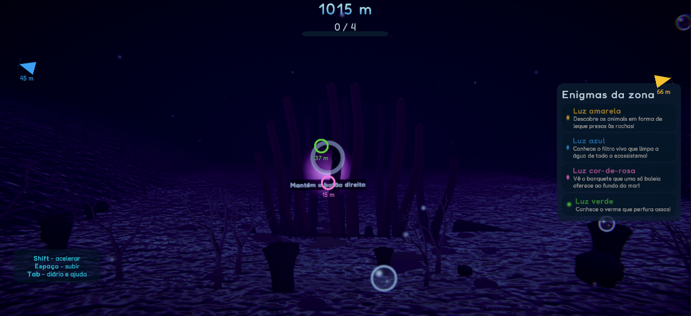
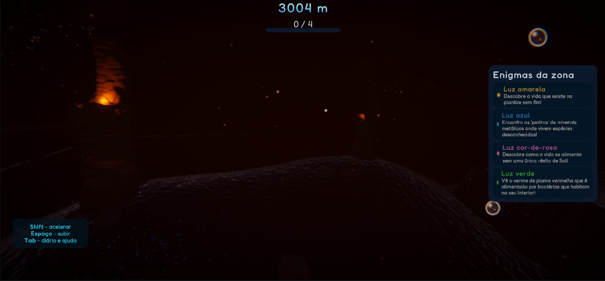
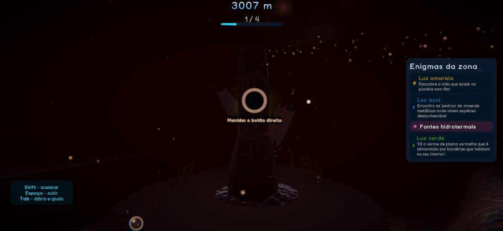
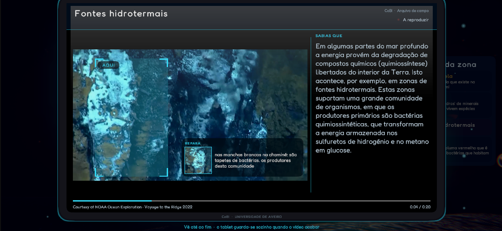
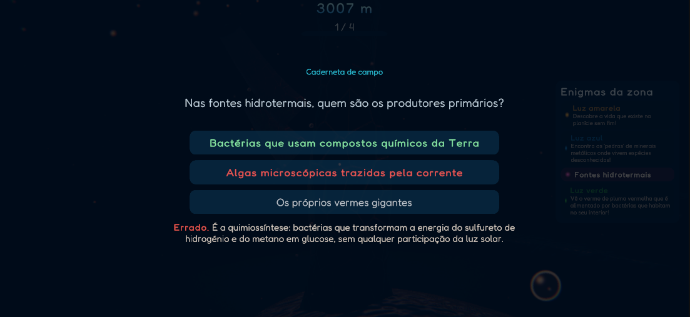

# Os Segredos do Fundo do Mar

Jogo educativo de exploração subaquática em primeira pessoa (Windows). / First-person educational underwater exploration game (Windows).

## Download

**[Descarregar a versão mais recente / Download the latest version](https://github.com/pedrotorres1001/OsSegredosDoFundoDoMar/releases/latest)**

Extrai o zip e abre `OsSegredosdoFundodoMar.exe`. Se o Windows mostrar o aviso *O Windows protegeu o seu PC*, clica em **Mais informações** e depois em **Executar mesmo assim**. / Extract the zip and run `OsSegredosdoFundodoMar.exe`. If SmartScreen warns, click **More info**, then **Run anyway**.

## Capturas / Screenshots

| | |
|---|---|
|  |  |
|  |  |
|  |  |

## Sobre o jogo / About

**Os Segredos do Fundo do Mar** é um jogo de exploração subaquática em primeira pessoa que te leva do mar aberto até à planície abissal, a mais de três mil metros de profundidade.

Em cada uma das três zonas tens quatro enigmas. Cada um descreve um organismo ou um processo pelo que ele faz: o leque que trava a corrente, o verme que perfura ossos, as chaminés que alimentam vida sem um único raio de sol. Tens de o encontrar no escuro e identificá-lo. Quando acertas, abre uma filmagem real do fundo do mar, com uma ficha ao lado, e uma pergunta para veres o que ficou.

- Três ambientes de profundidade crescente: florestas de coral negro, campos de gorgónias e uma carcaça de baleia, fontes hidrotermais e nódulos na planície abissal
- Doze organismos e processos, com conteúdo científico definido e revisto pela Coleção Biológica de Apoio à Investigação (CoBI) da Universidade de Aveiro
- Vídeo real de campanhas científicas
- Não há forma de perder: uma sessão dura cerca de 20 minutos
- Pensado a partir dos 10 anos e calibrado para o 2.º ciclo do ensino básico
- Em português e em inglês; joga-se com rato e teclado ou com comando

**Controlos:** WASD ou setas para nadar, rato para olhar, Shift para acelerar, Espaço para subir, Tab para o diário e a ajuda, botão direito (manter premido) para identificar.

**Instalação:** descarrega o zip, extrai a pasta e abre `OsSegredosdoFundodoMar.exe`. Não precisa de instalação nem de privilégios de administrador. O jogo ajusta a qualidade gráfica sozinho em computadores mais fracos.

O jogo foi desenvolvido no âmbito da dissertação de Mestrado em Desenvolvimento de Jogos Digitais da Universidade de Aveiro, em colaboração com a CoBI do Departamento de Biologia.

---

**Secrets of the Deep Sea** is a first-person underwater exploration game that takes you from the open sea down to the abyssal plain, more than three thousand metres deep.

Each of the three zones has four riddles. Each one describes an organism or a process by what it does, and you have to find it in the dark and identify it. Get it right and real deep-sea footage opens, with a fact sheet beside it, followed by a question.

- Three environments of increasing depth
- Twelve organisms and processes, with scientific content defined and reviewed by the Biological Research Collection (CoBI) of the University of Aveiro
- Real footage from scientific expeditions
- You can't lose; a session takes about 20 minutes
- For ages 10 and up; Portuguese and English; mouse and keyboard or gamepad

Made as part of a Master's dissertation in Digital Game Development at the University of Aveiro, in collaboration with CoBI, Department of Biology.

---

### Créditos / Credits

**Desenvolvimento:** Pedro Torres
**Orientação:** Pedro Beça (Universidade de Aveiro) e Ascensão Ravara (Departamento de Biologia, Universidade de Aveiro)
**Conteúdo científico:** Coleção Biológica de Apoio à Investigação (CoBI), Departamento de Biologia, Universidade de Aveiro

Foram usadas ferramentas de inteligência artificial como apoio no desenvolvimento; todo o conteúdo foi revisto pelo autor, e o conteúdo científico pela CoBI. / AI tools were used as support during development; all content was reviewed by the author, and the scientific content by CoBI.

**Vídeo e imagem / Footage and images**
- © CoBI · projeto COAST (três excertos)
- Courtesy of NOAA Ocean Exploration (incluindo *DEEP SEARCH 2019* e *Voyage to the Ridge 2022*)
- Courtesy of NOAA Ocean Exploration / USGS
- Peter van Rodijnen · Wikimedia Commons · CC BY-SA 3.0 NL
- Foto: Syced · Wikimedia Commons · CC0 1.0
